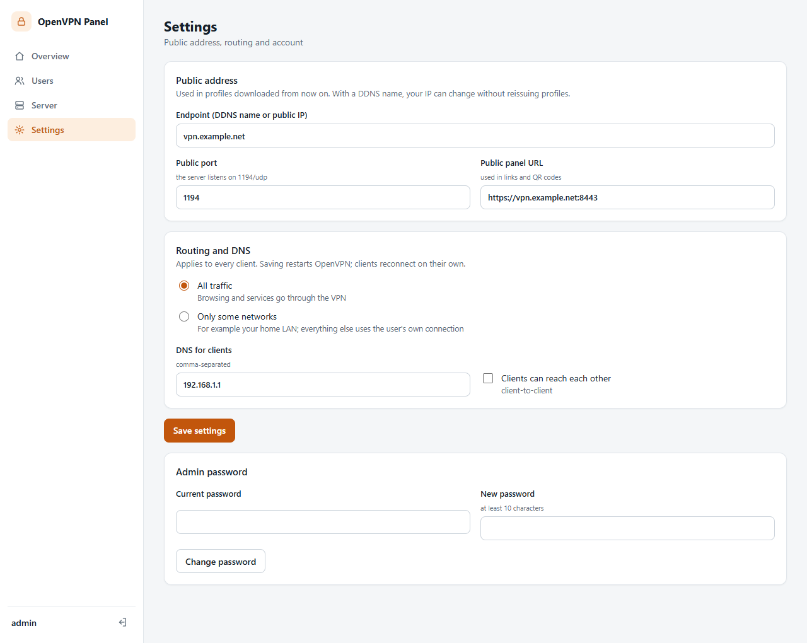

# OpenVPN Panel

A small web dashboard to run an OpenVPN server, plus a one-command installer that creates a ready-to-use
LXC container on **Proxmox VE**.

Create a user, show the QR code, and the user is connected a minute later from their phone.


## Features

- **One-command install on Proxmox**: creates an unprivileged Debian 12 container with OpenVPN, the PKI,
  NAT and the panel, all as systemd services.
- **Users**
  - one click creates a client certificate;
  - a QR code opens an activation page where the user downloads the profile for OpenVPN Connect;
  - `.ovpn` download, disable / enable, renew the certificate (lost device), delete.
- **Live view**: who is connected, from where, with which VPN IP and how much traffic; force a disconnect.
- **Server**: status, version, uptime, traffic and logs; restart from the browser.
- **Settings**: public endpoint (DDNS name or IP), public port, full or split tunnel, DNS, client-to-client.
- **Modern defaults**: EC certificates, `tls-crypt`, AES-256-GCM / ChaCha20-Poly1305, CRL-based revocation.
- **Light and dark theme**, usable from a phone.

The panel talks to OpenVPN through its **management interface**. It reads clients, state and statistics,
and disconnects clients live without editing OpenVPN's files. It also generates `server.conf` from the settings.

## Screenshots

| Users | Sharing a profile |
|---|---|
|  |  |
| **Server status and log** | **Settings** |
|  |  |
| **Dark theme** | **Activation page on the phone** |
|  |  |

The screenshots use sample data: names and addresses are fictional.

## Quick start

In the **Shell** of your Proxmox node (*Datacenter → your node → Shell*):

```bash
bash -c "$(curl -fsSL https://raw.githubusercontent.com/v3l1d/ovpn-panel/main/proxmox/create-ct.sh)"
```

The script:
1. asks for your DDNS name or public IP;
2. shows what it will create and asks for confirmation;
3. prints the panel address, user name and password at the end.

Then forward **1194/udp** on your router to the container IP.

The [installation guide](docs/INSTALL.md) covers the details:
- every installer option, offline installs and installs on an existing Debian 12 system;
- upgrades, backups and uninstalling;
- troubleshooting.

## Requirements

- Proxmox VE 7 or later (any node with Internet access), or any Debian 12 system with systemd for a manual install
- A public IPv4 address, or a DDNS name pointing to it, and the ability to forward one UDP port on your router
- Clients: [OpenVPN Connect](https://openvpn.net/client/) or any OpenVPN 2.5+ client

## How it works

```
                 Proxmox VE node
┌────────────────────────────────────────────────────┐
│  LXC container (Debian 12, unprivileged)           │
│                                                    │
│   ovpn-panel (FastAPI, HTTPS :8443)                │
│     ├─ management socket ─► openvpn-server@server  │◄── 1194/udp ── clients
│     ├─ easy-rsa PKI (issue / revoke / CRL)         │
│     └─ SQLite: admins, users, settings             │
│   iptables NAT 10.9.0.0/24 ─► LAN / Internet       │
└────────────────────────────────────────────────────┘
```

- **One user = one client certificate.** Profiles are rebuilt from the PKI on demand, so a new download
  link can be generated at any time.
- **Activation links** are random, expire after 72 hours and stop working as soon as the user is disabled,
  renewed or deleted.
- **Settings take effect in two ways.** Routing and DNS changes rewrite `server.conf` and restart OpenVPN:
  clients reconnect on their own. Endpoint and port changes only affect profiles downloaded afterwards.

## Security notes

- **Do not expose the panel to the Internet.** Only the OpenVPN port needs forwarding; the panel works fine
  from your LAN. If users must open activation links from outside, put the panel behind a reverse proxy
  with a valid certificate. See [Exposing the panel](docs/INSTALL.md#exposing-the-panel-optional).
- **Logins:** admin passwords are hashed with scrypt, sessions expire after 12 hours, and an IP is locked
  out for 10 minutes after 5 failed logins.
- **Self-signed certificate:** browsers show a warning the first time.
- **Profiles contain private keys.** Treat activation links like passwords: they are personal and short-lived.

## Development

The whole installer can be tested without a Proxmox node:

```bash
bash tests/run.sh
```

`tests/run.sh` does three things:

1. **Simulated Proxmox node.** Builds the installer and runs it on a Debian 12 container with systemd,
   where `pct`, `pveam`, `pvesh` and `pvesm` are simulated. `pct exec` runs commands for real, so
   `install.sh` really installs everything.
2. **Real OpenVPN client.** Connects one and checks:
   - user creation, the activation page and the tunnel;
   - NAT, disconnecting, disabling and renewing users;
   - the split-tunnel settings and restarts.
3. **Restart.** Restarts the node and checks that every service comes back.

It needs Docker. The test panel stays available at <https://localhost:9443> afterwards.

The simulation does not cover the Proxmox-specific parts: real `pct` behavior, templates, storage and
LXC permissions.

```
app/
  install.sh            installer for Debian 12 (runs inside the container)
  ovpnpanel/
    main.py             HTTP API and pages
    mgmt.py             OpenVPN management interface client
    pki.py              certificates (easy-rsa), revocation, .ovpn profiles
    serverconf.py       server.conf generated from the settings
    settings.py         settings editable from the panel
    manage.py           CLI: init, create-admin, reset-password
    static/             dashboard and activation page
proxmox/create-ct.sh    Proxmox installer (create or --update a container)
tools/build.py          builds dist/ovpn-panel-proxmox.sh with the app embedded (offline installs)
tests/                  simulated Proxmox node and end-to-end tests
```

## License

ovpn-panel is free software, released under the [GNU General Public License v3.0](LICENSE).
You can use, study, share and modify it. If you distribute a modified version, you must release its
source code under the same license.
