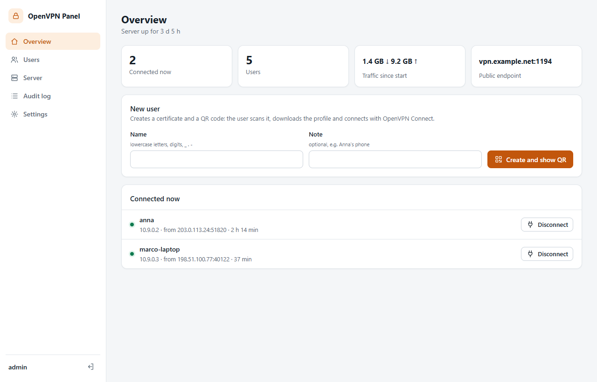
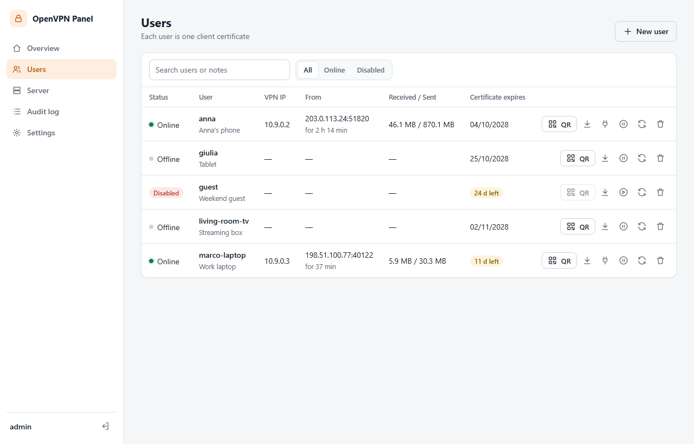
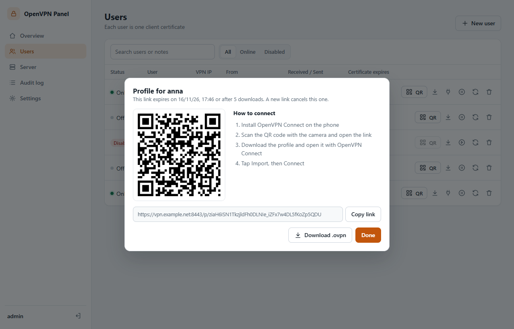
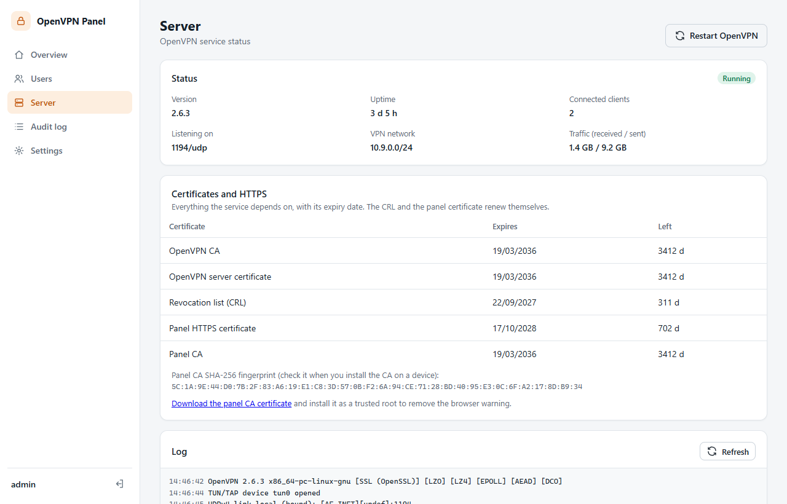
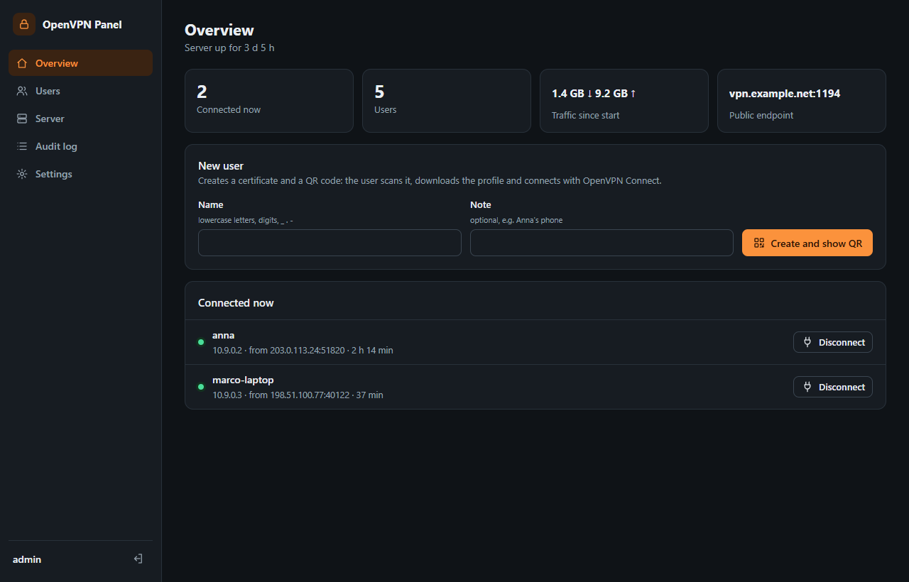
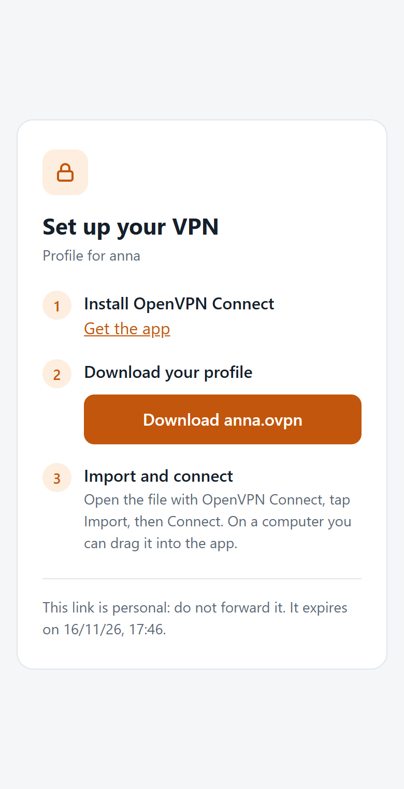
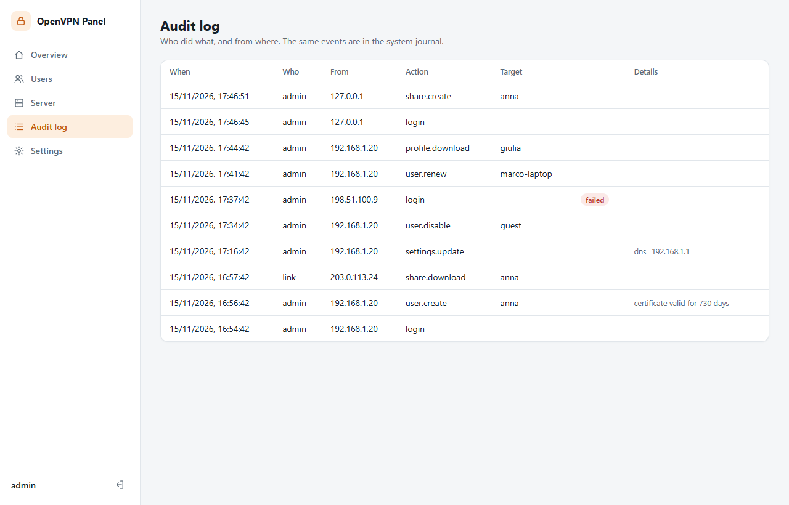

# OpenVPN Panel

A small web dashboard to run an OpenVPN server, plus a one-command installer that creates a hardened,
ready-to-use LXC container on **Proxmox VE**.

Create a user, show the QR code, and the user is connected a minute later from their phone.



## Features

- **One-command install on Proxmox**: creates an unprivileged Debian 12 container with OpenVPN, the PKI,
  the firewall and the panel, all as systemd services. The download is pinned to a release and verified.
- **Users**
  - one click creates a client certificate;
  - a QR code opens an activation page where the user downloads the profile for OpenVPN Connect;
  - `.ovpn` download, disable / enable, renew the certificate (lost device), delete;
  - certificate expiry shown per user, and configurable (2 years by default).
- **Live view**: who is connected, from where, with which VPN IP and how much traffic; force a disconnect.
- **Server**: status, version, uptime, traffic, logs and certificate expiry dates; restart from the browser.
- **Settings**: public endpoint (DDNS name or IP), public port, full or split tunnel, DNS, client-to-client.
- **Audit log** of who did what, from where.
- **Encrypted backup and restore** of the PKI, database and configuration.
- **Light and dark theme**, usable from a phone.

The panel talks to OpenVPN through its **management interface**: it reads clients, state and statistics, and
disconnects clients live without editing OpenVPN's files.

## Security at a glance

- **Privilege separation.** The panel runs as an unprivileged, sandboxed user. Everything that needs root goes
  through a small helper with a fixed list of validated operations. The CA key is never readable by the panel.
- **Not exposed.** A firewall rule lets only your local network reach the dashboard: not the Internet, and
  not VPN clients either. VPN clients cannot reach each other.
- **HTTPS only**, with a private CA, a host-name allow-list, a strict Content-Security-Policy and no trust in
  the `Host` header.
- **Safe operations.** Renewing a certificate is atomic with rollback; bad settings are rolled back if OpenVPN
  does not start.
- **Sessions and logins.** Hashed tokens with expiry, a persistent login lockout, no user enumeration.
- **Supply chain.** Versioned releases, files verified against a hash before installing, dependencies locked
  with hashes.

Details, limits and how each point is tested: [docs/SECURITY.md](docs/SECURITY.md).

## Screenshots

| Users | Sharing a profile |
|---|---|
|  |  |
| **Server status and log** | **Settings** |
|  |  |
| **Dark theme** | **Activation page on the phone** |
|  |  |

**Audit log**: who did what, and from where



The screenshots use sample data: names and addresses are fictional.

## Quick start

In the **Shell** of your Proxmox node (*Datacenter → your node → Shell*):

```bash
bash -c "$(curl -fsSL https://raw.githubusercontent.com/v3l1d/ovpn-panel/v1.0.0/proxmox/create-ct.sh)"
```

The address contains a release tag, so you run exactly what was released, and the script verifies the files it
downloads. To read it first, download it and run it afterwards (see the [installation guide](docs/INSTALL.md)).

The script:
1. asks for your DDNS name or public IP;
2. shows what it will create and asks for confirmation;
3. prints the panel address, user name and password at the end.

Then forward **1194/udp** on your router to the container IP. Do not forward the panel port.

The [installation guide](docs/INSTALL.md) covers the details:
- every installer option, offline installs and installs on an existing Debian 12 system;
- upgrades, backup and restore, the command line, and uninstalling;
- exposing the activation pages safely, and troubleshooting.

## Requirements

- Proxmox VE 7 or later (any node with Internet access), or any Debian 12 system with systemd for a manual install
- A public IPv4 address, or a DDNS name pointing to it, and the ability to forward one UDP port on your router
- Clients: [OpenVPN Connect](https://openvpn.net/client/) or any OpenVPN 2.5+ client

## How it works

```
                      Proxmox VE node
┌────────────────────────────────────────────────────────────┐
│  LXC container (Debian 12, unprivileged)                   │
│                                                            │
│   ovpn-panel   (unprivileged, sandboxed, HTTPS :8443)      │
│        │ unix socket                                       │
│   ovpn-panel-helper (root, 13 validated operations)        │
│        ├─ easy-rsa PKI (issue / revoke / CRL)              │
│        ├─ server.conf (generated from validated settings)  │
│        └─ OpenVPN management socket ─► openvpn-server      │◄── 1194/udp ── clients
│   firewall: NAT, client isolation, panel port = LAN only   │
└────────────────────────────────────────────────────────────┘
```

- **One user = one client certificate.** Profiles are rebuilt from the PKI on demand, so a new download
  link can be generated at any time.
- **Activation links** are random, last 24 hours or 5 downloads by default, and stop working as soon as the user
  is disabled, renewed or deleted.
- **Settings take effect in two ways.** Routing and DNS changes rewrite `server.conf` and restart OpenVPN:
  clients reconnect on their own. Endpoint, port and certificate-policy changes only affect profiles
  and certificates created afterwards.

## Development

```bash
bash tests/run-unit.sh      # 240 unit and security tests, in a clean Debian 12 / Python 3.11 container
bash tests/run.sh           # full integration run on a simulated Proxmox node (Docker)
```

`tests/run.sh` does five things:

1. **Upgrade.** Installs the previous release, creates users, upgrades it in place, and checks that a
   profile issued before the upgrade still connects.
2. **System checks.** Which user runs what, which files each user can read, the sandbox seen from inside its
   mount namespace, the helper socket, the firewall rules.
3. **Real OpenVPN clients**, one of them in its own network namespace: connecting, NAT, the firewall (the panel
   unreachable from the VPN, clients unable to reach each other), certificate lifetime, activation links,
   sessions, audit log, settings and restarts.
4. **Disaster recovery.** Backs up, destroys the PKI and the database, restores, and checks that old certificates
   still work and revoked ones are still refused.
5. **Lockout and restart.** A login lockout that survives a restart of the whole container.

The simulation does not cover the Proxmox-specific parts: real `pct` behavior, templates, storage and
LXC permissions.

To publish a release: `python tools/release.py X.Y.Z`, commit, tag `vX.Y.Z`, push. It pins the installer to
that tag and to the hash of the application files.

```
app/
  install.sh            installer for Debian 12 (runs inside the container)
  firewall.sh           NAT, client isolation and panel access rules
  requirements.lock     dependencies with hashes (generated from requirements.in)
  ovpnpanel/
    main.py             HTTP API and pages (unprivileged)
    helper_client.py    how the panel talks to the helper
    settings.py         settings editable from the panel
    helper/             everything that runs as root
      server.py           the helper daemon and its socket
      ops.py              the 13 operations it offers
      pki.py              certificates (easy-rsa)
      serverconf.py       server.conf generation
      tlsca.py            private CA for the panel's HTTPS certificate
      backup.py           encrypted backup and restore
      admin.py            root command line (ovpn-panel ...)
    static/             dashboard and activation page
proxmox/create-ct.sh    Proxmox installer (create or --update a container)
tools/release.py        pins a release; tools/build.py builds the offline installer
tests/                  unit tests, simulated Proxmox node, end-to-end tests
docs/                   installation guide, security notes, screenshots
```

## License

ovpn-panel is free software, released under the [GNU General Public License v3.0](LICENSE).
You can use, study, share and modify it. If you distribute a modified version, you must release its
source code under the same license.
